# Database Schema Architecture Document
**Project:** Brightloop Software — Subscription Management System (SubscriptIQ)  
**Version:** 1.0.0 (Foundation Stage)  
**Database Engine:** PostgreSQL 16  
**ORM:** SQLAlchemy 2.0  
**Migration Framework:** Alembic  

---

## 1. Architectural Principles

1. **Relational Integrity & ACID Compliance:** All financial transactions, billing records, and subscription state changes adhere strictly to ACID properties using PostgreSQL foreign keys, check constraints, and unique indexes.
2. **UUIDv4 Primary Keys:** All tables utilize globally unique UUIDv4 identifiers (`uuid_generate_v4()` or application-level UUIDs) to prevent enumeration attacks and simplify distributed data ingestion.
3. **Multi-Tenancy Foundation:** Every domain entity is partitioned logically by `organization_id`, ensuring strict tenant isolation across organizations, enterprises, and accounts.
4. **Timezone-Aware Timestamps:** All datetime columns (`created_at`, `updated_at`, `period_start`, `period_end`) are stored as `TIMESTAMP WITH TIME ZONE` (`TIMESTAMPTZ`) normalized to UTC.
5. **Monetary Precision:** All currency amounts are represented using fixed-precision `NUMERIC(12, 2)` (and `NUMERIC(5, 2)` for tax percentages) to completely eliminate floating-point rounding errors while matching standard accounting decimal representations. Historical unit prices, tax amounts, and discount amounts are permanently preserved in invoice line snapshots.

---

## 2. Entity-Relationship Diagram (ERD)

```mermaid
erDiagram
    ORGANIZATIONS ||--o{ USERS : "employs"
    ORGANIZATIONS ||--o{ CUSTOMERS : "manages"
    ORGANIZATIONS ||--o{ PRODUCTS : "catalogs"
    ORGANIZATIONS ||--o{ COUPONS : "offers"
    PRODUCTS ||--o{ PLANS : "contains"
    CUSTOMERS ||--o{ SUBSCRIPTIONS : "subscribes_to"
    CUSTOMERS ||--o{ QUOTATIONS : "requests"
    CUSTOMERS ||--o{ INVOICES : "receives"
    PLANS ||--o{ SUBSCRIPTIONS : "defines"
    SUBSCRIPTIONS ||--o{ SUBSCRIPTION_ITEMS : "comprises"
    SUBSCRIPTIONS ||--o{ INVOICES : "generates"
    INVOICES ||--o{ INVOICE_ITEMS : "details"
    INVOICES ||--o{ PAYMENTS : "reconciles"
    QUOTATIONS ||--o| SUBSCRIPTIONS : "converts_into"
    ORGANIZATIONS ||--o{ AUDIT_LOGS : "records"

    ORGANIZATIONS {
        uuid id PK
        string name
        string slug UK
        string billing_email
        string default_currency
        string timezone
        string status
        timestamptz created_at
        timestamptz updated_at
    }

    USERS {
        uuid id PK
        uuid organization_id FK
        string email UK
        string password_hash
        string full_name
        string role
        boolean is_active
        timestamptz created_at
        timestamptz updated_at
    }

    CUSTOMERS {
        uuid id PK
        uuid organization_id FK
        uuid user_id FK
        string name
        string email
        string phone
        string tax_id
        string currency
        jsonb billing_address
        jsonb metadata
        timestamptz created_at
        timestamptz updated_at
    }

    PRODUCTS {
        uuid id PK
        uuid organization_id FK
        string name
        string code
        string description
        boolean is_active
        jsonb metadata
        timestamptz created_at
        timestamptz updated_at
    }

    PLANS {
        uuid id PK
        uuid product_id FK
        string name
        string code
        string billing_interval
        integer billing_interval_count
        bigint price_cents
        string currency
        integer trial_period_days
        string pricing_model
        boolean is_active
        timestamptz created_at
        timestamptz updated_at
    }

    SUBSCRIPTIONS {
        uuid id PK
        uuid organization_id FK
        uuid customer_id FK
        uuid plan_id FK
        string status
        integer quantity
        timestamptz start_date
        timestamptz trial_start
        timestamptz trial_end
        timestamptz current_period_start
        timestamptz current_period_end
        boolean cancel_at_period_end
        timestamptz canceled_at
        timestamptz paused_at
        integer renewal_count
        timestamptz created_at
        timestamptz updated_at
    }

    SUBSCRIPTION_ITEMS {
        uuid id PK
        uuid subscription_id FK
        uuid product_id FK
        uuid plan_id FK
        integer quantity
        bigint unit_price_cents
        timestamptz created_at
        timestamptz updated_at
    }

    QUOTATIONS {
        uuid id PK
        uuid organization_id FK
        uuid customer_id FK
        string quote_number UK
        string status
        timestamptz valid_until
        bigint subtotal_cents
        bigint discount_cents
        bigint tax_cents
        bigint total_cents
        text notes
        uuid converted_subscription_id FK
        timestamptz created_at
        timestamptz updated_at
    }

    INVOICES {
        uuid id PK
        uuid organization_id FK
        uuid subscription_id FK
        uuid customer_id FK
        string invoice_number UK
        string status
        timestamptz due_date
        timestamptz paid_at
        bigint subtotal_cents
        bigint discount_cents
        bigint tax_cents
        bigint total_cents
        string currency
        string billing_reason
        string pdf_url
        timestamptz created_at
        timestamptz updated_at
    }

    INVOICE_ITEMS {
        uuid id PK
        uuid invoice_id FK
        uuid subscription_item_id FK
        string description
        integer quantity
        bigint unit_price_cents
        bigint amount_cents
        boolean proration
        timestamptz period_start
        timestamptz period_end
        timestamptz created_at
    }

    PAYMENTS {
        uuid id PK
        uuid organization_id FK
        uuid invoice_id FK
        string payment_method
        string gateway
        string gateway_transaction_id
        bigint amount_cents
        string currency
        string status
        string error_message
        timestamptz processed_at
        timestamptz created_at
    }

    COUPONS {
        uuid id PK
        uuid organization_id FK
        string code UK
        string discount_type
        numeric discount_value
        string currency
        string duration
        integer duration_in_months
        integer max_redemptions
        integer times_redeemed
        timestamptz expires_at
        boolean is_active
        timestamptz created_at
        timestamptz updated_at
    }

    AUDIT_LOGS {
        uuid id PK
        uuid organization_id FK
        uuid user_id FK
        string action
        string entity_type
        uuid entity_id
        jsonb changes_json
        string ip_address
        timestamptz created_at
    }
```



---

## 3. Data Dictionary & Table Specifications

### 3.1. `organizations` (Tenants)
| Column | Type | Constraints | Description |
|---|---|---|---|
| `id` | UUID | PK, NOT NULL | Unique tenant identifier |
| `name` | VARCHAR(255) | NOT NULL | Organization name |
| `slug` | VARCHAR(100) | UNIQUE, NOT NULL | URL-safe identifier |
| `billing_email` | VARCHAR(255) | NOT NULL | Financial communications address |
| `default_currency` | VARCHAR(3) | NOT NULL, DEFAULT 'USD' | ISO 4217 currency code |
| `timezone` | VARCHAR(50) | NOT NULL, DEFAULT 'UTC' | IANA timezone identifier |
| `status` | VARCHAR(32) | NOT NULL, DEFAULT 'active' | Status: `active`, `suspended`, `archived` |
| `created_at` | TIMESTAMPTZ | NOT NULL, DEFAULT NOW() | Record creation timestamp |
| `updated_at` | TIMESTAMPTZ | NOT NULL, DEFAULT NOW() | Last update timestamp |

### 3.2. `users` (Authentication & RBAC)
| Column | Type | Constraints | Description |
|---|---|---|---|
| `id` | UUID | PK, NOT NULL | Unique user identifier |
| `organization_id` | UUID | FK -> organizations(id) | Associated organization |
| `email` | VARCHAR(255) | UNIQUE, NOT NULL | Login credential (normalized lowercase) |
| `hashed_password` | VARCHAR(255) | NOT NULL | Argon2id secure password hash |
| `full_name` | VARCHAR(255) | NOT NULL | Display name |
| `role` | VARCHAR(50) | NOT NULL, CHECK in ('admin','staff','customer') | RBAC authorization role |
| `is_active` | BOOLEAN | NOT NULL, DEFAULT TRUE | Account lock flag |
| `created_at` | TIMESTAMPTZ | NOT NULL, DEFAULT NOW() | Record creation timestamp |
| `updated_at` | TIMESTAMPTZ | NOT NULL, DEFAULT NOW() | Last update timestamp |

### 3.3. `customers` (Subscriber Profiles)
| Column | Type | Constraints | Description |
|---|---|---|---|
| `id` | UUID | PK, NOT NULL | Unique customer account ID |
| `organization_id` | UUID | FK -> organizations(id) | Tenant owner |
| `user_id` | UUID | FK -> users(id), NULLABLE | Portal login linkage |
| `name` | VARCHAR(255) | NOT NULL | Company or individual customer name |
| `email` | VARCHAR(255) | NOT NULL | Primary billing email |
| `phone` | VARCHAR(50) | NULLABLE | Contact telephone |
| `tax_id` | VARCHAR(50) | NULLABLE | VAT / GST / EIN identification |
| `currency` | VARCHAR(3) | NOT NULL, DEFAULT 'USD' | Preferred invoice currency |
| `billing_address` | VARCHAR(500) | NULLABLE | Structured address description |
| `is_active` | BOOLEAN | NOT NULL, DEFAULT TRUE | Customer active state |
| `created_at` | TIMESTAMPTZ | NOT NULL, DEFAULT NOW() | Record creation timestamp |
| `updated_at` | TIMESTAMPTZ | NOT NULL, DEFAULT NOW() | Last update timestamp |

### 3.4. `products`, `product_variants`, `plans` & `plan_products`
- **`products`**: Root software catalog entry (name, unique code, description, active state).
- **`product_variants`**: Specific variant tier (name, unique sku, `price NUMERIC(12, 2)`).
- **`plans`**: Billing frequency tier (name, unique code, `billing_interval`, `billing_interval_count`, `price NUMERIC(12, 2)`, `trial_period_days`).
- **`plan_products`**: Many-to-many relationship linking Plans to catalog Products and optional Variants with item quantity.

### 3.5. `subscriptions` & `subscription_lines`
- **`subscriptions`**: Customer recurring contracts with unique `subscription_number`, status (`active`, `paused`, `canceled`, etc.), `current_period_start`, `current_period_end`, and cancellation tracking.
- **`subscription_lines`**: Itemized service lines linked to products/variants with unit price (`NUMERIC(12, 2)`) and quantity.

### 3.6. `invoices` & `invoice_lines`
- **`invoices`**: Billing invoice with unique `invoice_number`, status (`draft`, `open`, `paid`, `void`, `uncollectible`), `due_date`, `paid_at`, `subtotal`, `discount_amount`, `tax_amount`, and `total` (all `NUMERIC(12, 2)`).
- **`invoice_lines`**: Immutable financial snapshot containing `unit_price`, `quantity`, `discount_amount`, `tax_rate`, `tax_amount`, and `total` (`NUMERIC(12, 2)`). Ensures future product catalog price adjustments never mutate previously issued invoices.

### 3.7. `payments`
- Financial ledger entries recording transaction references, payment method, `amount NUMERIC(12, 2)`, currency, processing timestamp, and payment status (`pending`, `succeeded`, `failed`).

### 3.8. `billing_events`
- Idempotency and renewal tracking records with database-level uniqueness constraint `uq_billing_event_subscription_period_type` on `(subscription_id, period_start, period_end, event_type)`.

### 3.9. `quotation_templates`, `quotations` & lines
- Reusable quotation templates with default line items and customer quotation proposals with itemized pricing snapshots.

### 3.10. `tax_rules` & `discount_rules`
- Regional tax specifications with `rate_percent NUMERIC(5, 2)` and promotional coupon rules with `value NUMERIC(12, 2)` and redemption tracking.

### 3.11. `password_reset_tokens`
- Secure cryptographic password reset records storing SHA-256 token hashes, expiration timestamps, and one-time `is_used` flags.

### 3.12. `audit_logs`
- Append-only audit log for tracking administrative actions, security mutations, and domain events with user and tenant foreign keys.

---

## 4. Indexing & Performance Strategy

```sql
-- Multi-tenant lookup indexes
CREATE INDEX idx_users_org ON users(organization_id);
CREATE INDEX idx_customers_org ON customers(organization_id);
CREATE INDEX idx_subscriptions_org_status ON subscriptions(organization_id, status);
CREATE INDEX idx_invoices_org_status ON invoices(organization_id, status);

-- Subscription renewal cron lookup index
CREATE INDEX idx_subscriptions_active_renewal 
ON subscriptions (status, current_period_end) 
WHERE status IN ('active', 'trialing');

-- Invoice search and lookup
CREATE INDEX idx_invoices_customer ON invoices(customer_id);
CREATE INDEX idx_invoices_due_date ON invoices(due_date) WHERE status = 'open';

-- JSONB indexing for customer metadata
CREATE INDEX idx_customers_metadata ON customers USING gin(metadata);
```

---

## 5. Migration Strategy via Alembic

1. **Alembic Engine Isolation:** Migrations utilize SQLAlchemy 2.0 metadata discovery via `app.models.Base.metadata`.
2. **Deterministic Versioning:** Revisions formatted with `YYYYMMDD_rev_slug` for strict chronological ordering.
3. **Reversible DDL:** All migrations define both `upgrade()` and `downgrade()` procedures.
